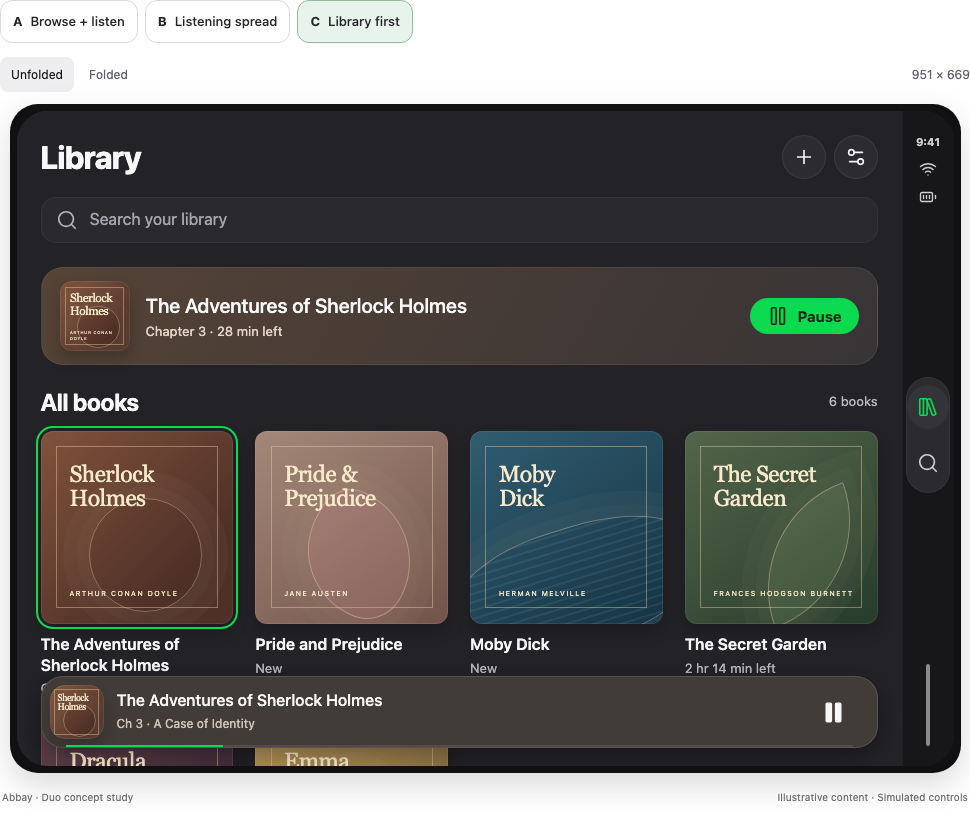
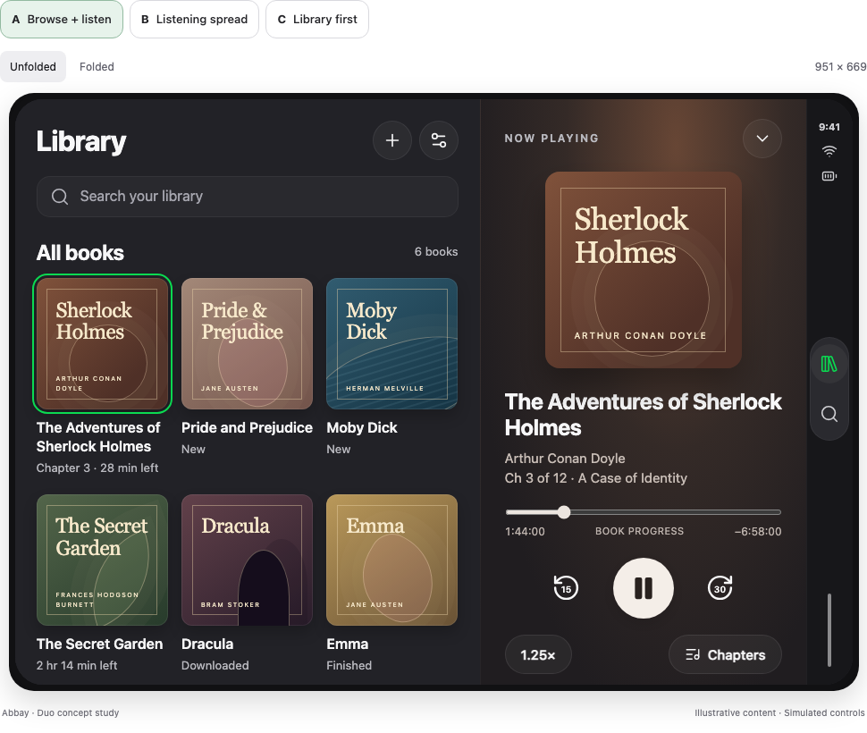
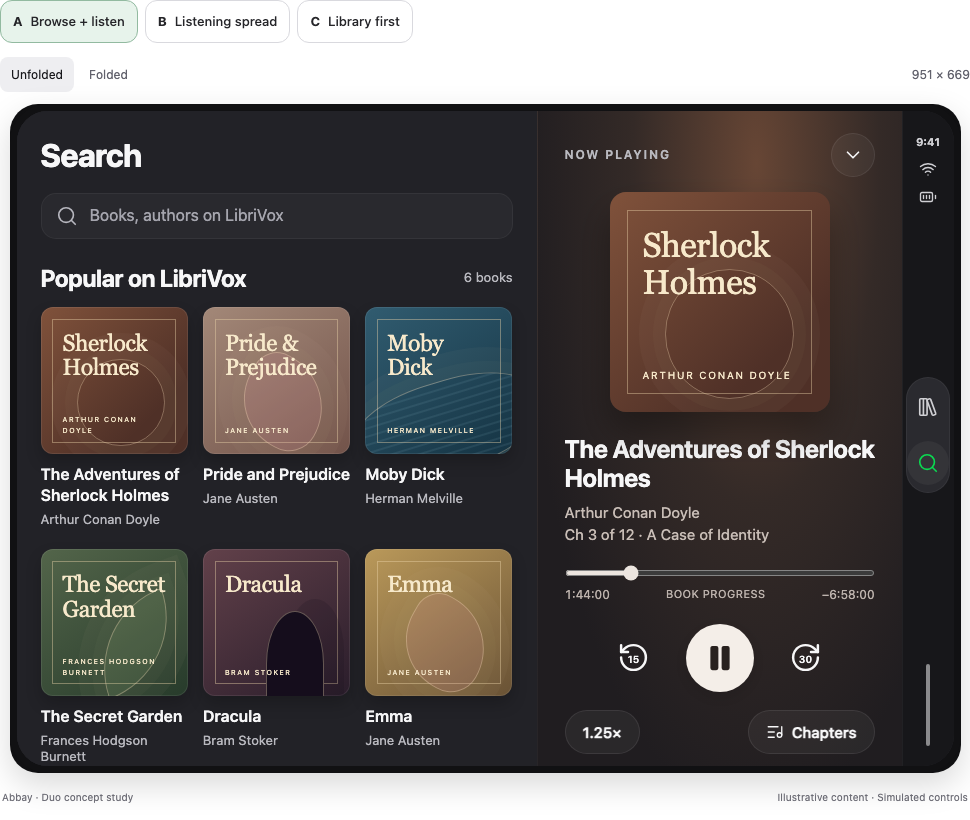
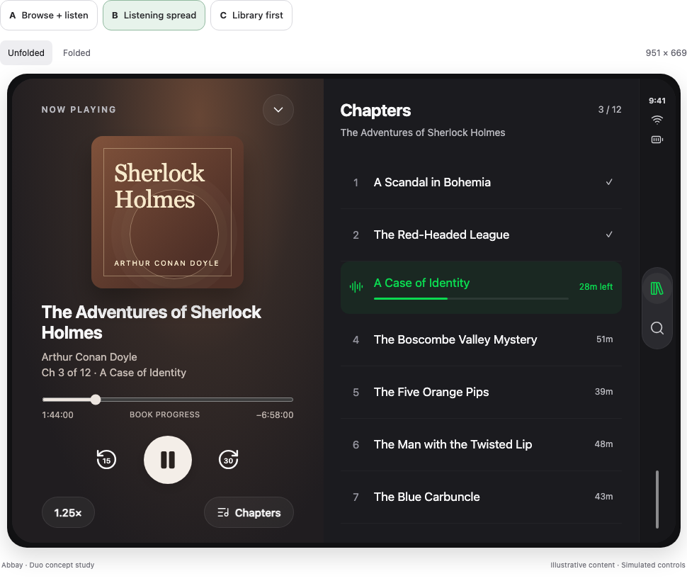
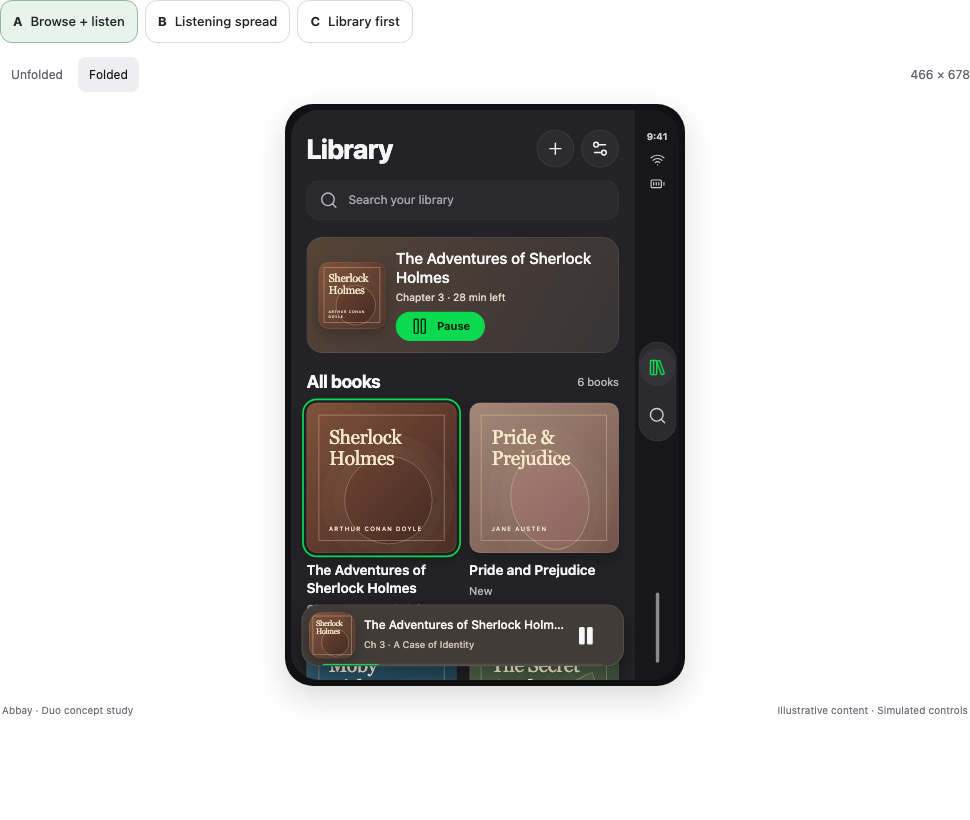
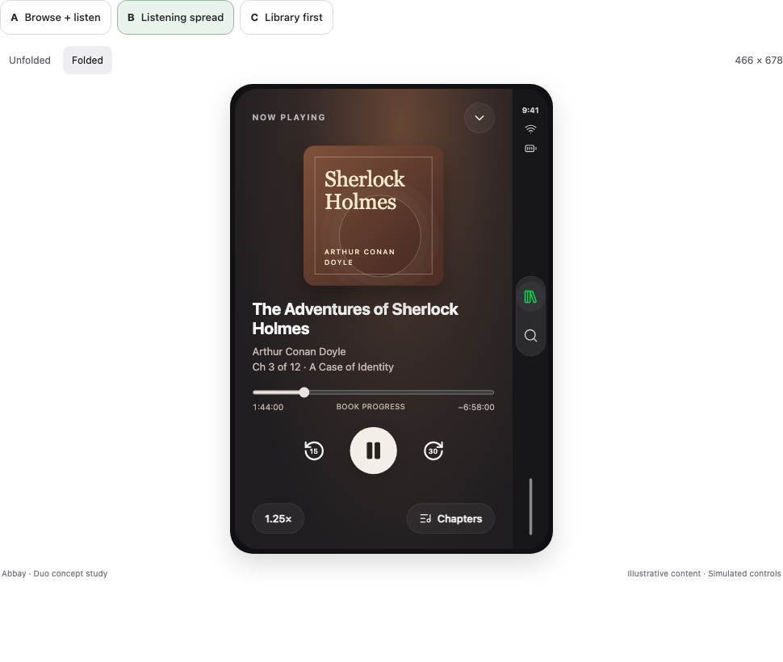

# Adaptive layouts for iPhone, iPhone Duo, and iPad

Date: 2026-10-27

Status: Agreed product direction; implementation pending. Exact layout thresholds, platform navigation placement, and transition mechanics require simulator validation.

Related issues: [#255, Duo layouts](https://github.com/mobyleOfficial/AbbayiOS/issues/255), [#251, outer-display grid clipping](https://github.com/mobyleOfficial/AbbayiOS/issues/251), [#243, player transition verification](https://github.com/mobyleOfficial/AbbayiOS/issues/243), and [#233, narrow-screen and large-text library verification](https://github.com/mobyleOfficial/AbbayiOS/issues/233).

## Outcome

Abbay uses one adaptive interface across regular iPhones, both Duo displays, and native iPad windows. Layout depends on the space available to the app and the user's text size. Device model names do not select separate screen implementations.

The interface has three user-controlled presentation states. The letters refer to the concepts reviewed during the design session:

- **C, browsing:** Library or Search occupies the available content area. A mini player appears when an audiobook is loaded, including while paused.
- **A, player open:** browsing and the player appear beside each other when space permits.
- **B, chapters open:** the player and its chapter list appear beside each other when space permits. The chapter list replaces the browsing pane.

A, B, and C are states of the same interface, not competing designs or playback modes. Starting or pausing audio does not automatically select a different layout. An explicit action that also opens the player, such as **Play** on a LibriVox details page, still opens it.

## Visual mockups

These images capture the reviewed concepts. They show proposed layouts with illustrative content, not screenshots of implemented app behavior. The navigation and adaptation rules below take precedence over the prototype controls and fixed canvas sizes. Wide compositions also guide roomy iPad windows; they are not separate iPad designs.

### C: Browsing with a loaded book

The library uses the available width and keeps playback in a compact bar. With no loaded book, the bar is absent.

### A: Library beside the player

Opening the player retains browsing beside it when both panes fit.

### A: LibriVox Search beside the player

Search uses the browsing pane. Selecting a result opens its catalog details there, including the catalog's own chapter list.

### B: Player beside chapters

The player's chapter list replaces browsing while the player remains visible.

### Narrow layout: Browsing

The library reduces its columns to fit the usable area. The prototype's A selector is a concept label; under the agreed state model, this browsing view is C.

### Narrow layout: Player

The player occupies one pane. Chapters opens the compact panel. The prototype's B selector does not mean the chapter panel is open in this capture.

## Existing behavior and implementation findings

The following findings describe the source inspected for this design, not completed adaptive behavior:

| Area | Current implementation | Consequence for this design |
| --- | --- | --- |
| App shell | `AppRootView` owns the Library and Search destinations, long-lived models, and a player overlay. | Navigation and playback state can remain above the adaptive presentation. |
| Player presentation | `PlayerPresentation.presentedBook` can differ from the loaded book. Opening a library book does not start audio. | A book can be inspected without replacing current playback. |
| Player model | `PlayerViewModel` reads shared playback, clock, and download state. A preview shows its saved position until played. | The different layouts can reuse playback behavior. |
| Player animation | `PlayerExpansionOverlay` lays out a full-screen player and animates its frame from a cover or mini player. | A split-pane destination requires presentation changes; the current animation cannot be assumed to fit unchanged. |
| Chapters | `ChaptersPanel` uses `ChapterListView` for current progress, chapter selection, and download status/retry. | B can reuse the chapter content without retaining the compact panel's dismiss-on-selection behavior. |
| Library | `MediaListView.columns` uses three columns, or two at larger text sizes. | Column count must depend on actual pane width and readable content sizes. |
| Catalog | Search opens `LibriVoxDetailView`, which loads its own details and chapter data. | Catalog details remain a separate destination from the player. |
| Catalog playback | `LibriVoxDetailViewModel.play()` starts playback, then calls `openPlayer`. Download enqueues a book without opening the player. | These distinct actions remain distinct. |
| Device configuration | `project.yml` and the generated project declare `TARGET_DEVICE_FAMILY: 1`; the plist contains separate iPad orientation/full-screen entries. | Existing iPad plist entries alone do not establish native iPad support. The effective build settings and built bundle require verification. |

The running Duo inner-display library was captured as a narrow centered layout with unused width. Other feature behavior was inspected in source, the feature map, and existing screenshots. A complete live navigation pass was not performed during the design session because native capture failed.

## Presentation behavior

### No loaded audiobook and paused playback

With no loaded audiobook, browsing fills the content area and no mini player appears. There is no empty player pane.

The existing **Continue** card remains eligible when the last-played book is still in the library and is unfinished. Its eligibility does not require an audiobook to be currently loaded. Existing search and empty-library rules still apply.

A paused audiobook remains loaded. Its mini player or open player stays visible. Pause, audio interruption, and playback completion do not collapse or open panes by themselves.

Opening an unplayed library book is valid even when nothing is loaded. The player shows that book's saved state without starting audio. Closing this preview returns to browsing without creating a mini player.

### Actions and destinations

| Action | Result |
| --- | --- |
| Tap a library book or the Continue card body | Open that book's player, A when space permits, without starting audio. |
| Tap the mini player | Open the loaded book's player. |
| Tap Resume/Pause on Continue or the mini player | Control playback; retain the current presentation state. |
| Tap Chapters in the player | Open B when space permits, or the compact chapter panel. |
| Close Chapters | Return to the player with browsing beside it when space permits. Restore the retained browsing destination. |
| Close the player | Return to C. Playback continues; show a mini player if a book is loaded. |
| Tap a chapter | Start that chapter of the presented book, preserving the existing load/switch semantics. B remains open; the compact panel retains its current dismissal behavior. |
| Tap Library or Search while B is open | Restore browsing beside the player on a wide layout, with the selected destination. On a narrow layout, show that destination and the mini player. |
| Fold, unfold, rotate, or resize | Reflow the current semantic state; do not start playback or choose a different book. |

A book without chapters has no Chapters action and cannot enter B. System-driven book changes retain the existing `PlayerViewModel` behavior for following the loaded book; a preview of another book must not silently control the loaded book.

### LibriVox has its own details page

Library selection and catalog selection are different actions:

1. A Search result or **GET** opens the existing catalog details destination.
2. That page shows its cover, metadata, description, download controls, and already-loaded chapter list.
3. **Download**, pause/resume download, and chapter retry retain the catalog page and current playback.
4. **Play** starts the selected audiobook and opens its player. Playback can stream unfinished downloads under the existing rules.
5. The player's **Chapters** action opens the playback chapter view, B or the compact panel.

Catalog chapter rows retain their current informational and download-retry behavior. They do not become player chapter-selection controls merely because the window is wide. B is an explicit player presentation; opening catalog details never substitutes B for that page.

In A, a catalog details destination occupies the browsing pane beside the player. Both can contain chapter-related information because they serve different purposes and can refer to different books. Downloading or inspecting one book must not change the other book's playback. Closing the player returns to the same catalog page, not the top of Search.

## Adaptive layout contract

### Semantic state and available space are separate

The app keeps a semantic presentation choice: browsing, player for a particular book, or chapters for that book. Separately, a layout decision determines whether that state fits in one pane or two.

The layout decision uses SwiftUI size classes, local container dimensions, safe areas, and Dynamic Type. It does not use device model strings, a cached main-screen size, orientation alone, or an assumption that all iPads have room for multiple panes.

| Semantic state | Narrow or constrained content area | Content area that fits two panes |
| --- | --- | --- |
| Browsing | Library/Search with optional mini player | C, with an adaptive grid and optional mini player |
| Player | Full-screen player | A, browsing beside the player |
| Chapters | Player with compact chapter panel | B, player beside a persistent chapter list |

An unfolded Duo can use a narrow presentation in multitasking. An iPad window can switch between the same presentations as it resizes. A regular iPhone uses the layout that fits its window, rather than an unconditional device exclusion.

Size classes provide the broad layout context. Actual usable width and height determine whether readable panes and controls fit. Pane minimum sizes account for padding, gaps, titles, and text scaling. Exact thresholds are an implementation measurement, not a device-size lookup table.

Large text can reduce grid columns, switch covers to rows, shrink decorative artwork, or require a single pane. Transport controls retain at least 44-point hit areas. Titles can wrap, and player/chapter content can scroll without hiding required actions.

### Safe areas and navigation

The mockups used illustrative 951 × 669-point inner and 466 × 678-point outer canvases with a 52-point right strip. These are design examples, not runtime constants.

The implementation uses system-provided insets and standard navigation placement. Each edge is handled independently; controls can appear on either side. Content width means the width offered to the pane after system navigation and safe-area layout, without subtracting the same inset twice.

Foreground content and controls clear system UI. Cover-derived backgrounds may extend behind it. The last library item and chapter row remain reachable above or beside persistent controls. Library columns fit the browsing pane, not the physical display.

Standard SwiftUI navigation containers are the preferred starting point. Whether `NavigationSplitView` can express the agreed transitions and retained destinations cleanly requires a prototype. The spec does not mandate a container that would lose the existing player interactions.

### State survives reflow

Playback ownership remains outside any conditional layout branch. A reflow preserves:

- The loaded book, play/pause state, position, playback speed, and download tasks.
- The presented book, which may differ from the loaded book.
- The selected Library/Search destination, query text, and pushed catalog details page.
- Browsing and chapter scroll positions, using stable item anchors where sizes change.
- The open player or chapter state and the existing per-book saved positions.

If B becomes narrow, its chapter list becomes the compact panel. Widening restores B. If A becomes narrow, the player remains foregrounded and browsing stays retained behind it. Resizing C never opens A just because more space becomes available.

Layout identity must not recreate the audio engine, restart catalog downloads, or discard navigation models. A geometry change during a drag settles or retargets that transition deterministically. It must not leave an invisible layer blocking touches. Reduce Motion avoids spatial interpolation while retaining the same destinations.

## Native iPad support

Native iPad support is part of this foundation. It includes effective universal-device configuration, iPad window resizing, supported orientations, and appropriate system presentations.

The implementation verifies Xcode's effective `TARGETED_DEVICE_FAMILY` and the built app's `UIDeviceFamily`. The repository currently spells its custom setting `TARGET_DEVICE_FAMILY`; changing that value without checking the generated result is insufficient evidence.

The app must run as a native iPad app rather than an iPhone compatibility window. iPad support does not introduce a separate playback model or a permanently forced multi-column layout. Narrow windows use the same constrained presentation as other devices.

Settings, speed selection, document import, alerts, and download confirmations use presentations appropriate to the current window. The iOS deployment target remains 17.0. Newer navigation or reserved-region APIs require availability checks and a working fallback.

## Code ownership and scope

The following boundaries describe responsibilities; final type names belong to implementation:

| Responsibility | Expected location |
| --- | --- |
| Retained tab navigation, catalog destination, and root models | `Abbay/View/Root/` |
| Semantic browsing/player/chapters state | Root presentation model, coordinated with `PlayerPresentation` |
| Pure layout decisions from traits and available dimensions | A small shared layout policy near the root |
| Player artwork, metadata, timeline, and transport | Reusable content under `Abbay/View/PlayerView/` |
| Compact overlay and interactive expansion | `Abbay/View/MiniPlayer/`, adapted to the current layout |
| Shared chapter rows and progress | `ChapterListView`, with separate compact-panel and persistent-pane presentation |
| Catalog details and download actions | Existing `LibriVoxDetailView` and model |
| Playback and download execution | Existing shared services; no new player per pane |

Playback ticks remain confined to the views that display time and progress. Opening a pane or changing a layout does not make the root observe the playback clock.

This work does not add sleep timers, bookmarks, queues, new catalog sections, sorting, or read-along text. The scrubber remains on whole-book time; [#228](https://github.com/mobyleOfficial/AbbayiOS/issues/228) is a separate product question. The existing dark theme, green accent, cover tint, and English/Portuguese localization remain.

The earlier [Liquid Glass design](2026-10-24-liquid-glass-redesign-design.md) still defines unaffected controls and styling. This spec replaces its fixed library column count and full-screen-only player composition where adaptation requires it.

## Acceptance criteria

The feature is complete when the following behavior is demonstrated in the running app:

- A fresh library shows no empty player pane or mini player. An eligible Continue card still works without a loaded book.
- Playing, pausing, and external playback changes do not unexpectedly rearrange the interface.
- C, A, and B follow the action table, including an unplayed preview while a different book is playing.
- Library import/search, Continue, context actions, deletion, and download indicators remain reachable.
- Catalog results open their own details and chapter list. Download stays there; Play starts audio and opens the player. Closing the player restores that details page.
- B keeps chapter selection visible, follows progress, and supports download status/retry. Compact chapter-panel behavior remains intact.
- Duo outer and inner displays have no clipped grid columns, covered controls, or accidental phone-width restriction on roomy windows.
- Folding, rotation, and window resizing preserve playback and retained destinations. Both leading and trailing system-inset configurations work.
- Native iPad launches without compatibility scaling. Full-size and narrow windows use the same adaptive rules.
- Large text, long book/chapter names, VoiceOver focus order, and Reduce Motion remain usable. Hidden panes are not accessibility targets.
- Existing regular-iPhone behavior remains functional on iOS 17 and the later supported presentation paths.

Verification covers a narrow regular iPhone, a larger regular iPhone, Duo folded/unfolded and multitasking configurations, and native iPad at full and reduced window sizes. State coverage includes no loaded book, paused playback, playing audio, another book previewed, books without chapters, long chapter lists, and incomplete/failed downloads. English and pt-BR screenshots use matching data.

Focused tests cover layout decisions and semantic transitions. Live verification proves safe-area fit, folding/resizing, scroll retention, uninterrupted audio, and accessibility behavior; compilation and screenshots alone do not prove those properties. The repository's lint, unit, and UI gates apply to the implementation. This documentation-only change does not alter app behavior.

The implementation updates the affected feature-map pages for the shell, tabs, library, player, mini player, and LibriVox details, plus settings/import/download pages where their behavior changes. Before/after evidence follows `CLAUDE.md`. Unresolved implementation gaps are linked to existing or new GitHub issues before merge.

## Remaining implementation decisions

The agreed behavior does not depend on these details, but implementation must resolve them:

- Measured minimum pane sizes and the conditions for falling back to one pane at large text sizes or short heights.
- Standard container composition and system navigation placement on each runtime.
- The transition from a tapped cover or mini player to a pane, including an interrupted transition during folding.
- Stable scroll restoration when a grid changes column count or a chapter pane becomes a compact panel.

The interactive concepts are visual references, not a complete navigation contract. The behavior and adaptation tables in this spec take precedence over prototype shortcuts. No hardcoded mockup dimensions or simulated download behavior carry into the app.

## Platform references

- [Prepare your app for iPhone Duo](https://developer.apple.com/videos/play/tech-talks/111461/): size classes, local scene geometry, adaptive navigation, asymmetric safe areas, and reserved regions. Apple describes compact horizontal size on the outer portrait display and regular horizontal/vertical size on the inner display; window constraints still affect the space available.
- [Apple layout guidance](https://developer.apple.com/design/human-interface-guidelines/layout): adaptive layouts and resizable windows.
- [Adopting SwiftUI navigation split view](https://developer.apple.com/documentation/technotes/tn3154-adopting-swiftui-navigation-split-view): multi-column navigation and compact collapse behavior.

Platform references were reviewed on 2026-10-27. The local feature map's compact-size description concerns the outer Duo display and must not be used as an assumption about the inner display.
